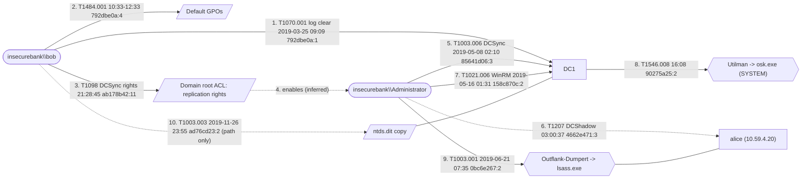

# insecurebank.local: Windows event log analysis

| | |
|---|---|
| Analyst | Claude (Forensic Hunter skill), worked example |
| Scope | 18 EVTX files, hosts `DC1.insecurebank.local` and `alice.insecurebank.local`, 2019-03-25 to 2019-11-26 |
| Tools | forhunt 0.1.0, Hayabusa 4.2.0 |
| Data | EVTX-ATTACK-SAMPLES (public lab captures, GPL-3.0); separate technique recordings treated as one case for demonstration |

## 1. Executive summary

The logs show an attacker with domain administrator access taking full
control of the `insecurebank.local` domain: the account `bob` cleared the DC
Security log, modified both default Group Policy objects and granted itself
directory replication rights on the domain root; `Administrator` then
replicated secrets from the DC (DCSync), registered a rogue domain controller
(DCShadow indicators), dumped LSASS memory on the workstation `alice` with the
Dumpert tool, copied the AD database (`ntds.dit`) with ntdsutil, installed an
accessibility-feature backdoor and disabled UAC on the DC. Logs were cleared
four times. All domain credentials must be considered compromised (High
confidence on the observed actions; the dataset is a lab, so intent and a
single actor are assumptions).

## 2. Evidence and integrity

| File | Host | SHA-256 (before = after) | Events | First | Last |
|---|---|---|---|---|---|
| ACL_ForcePwd_SPNAdd_User_Computer_Accounts.evtx | DC1 | f09f993909deb7ac… | 55 | 2019-03-25T09:09:14Z | 2019-03-25T13:01:41Z |
| DACL_DCSync_Right_Powerview__Add-DomainObjectAcl.evtx | DC1 | (see hashes-before.txt) | 28 | 2019-03-25T21:28:11Z | 2019-03-25T21:28:45Z |
| CA_DCSync_4662.evtx | DC1 | 679b2ff27af6c932… | 3 | 2019-05-08T02:10:43Z | 2019-05-08T02:10:43Z |
| … 15 more | | | | | |

Hashes before and after analysis match (`cmp` exit 0). No corrupt chunks or
records (`forhunt stats`: 0/0).

## 3. Key findings

**F1. Domain persistence via DCSync rights** - *High*
- Observed: `bob` cleared the DC Security log at 21:28:11 (`ab178b42:1`), then
  rewrote the `nTSecurityDescriptor` of `DC=insecurebank,DC=local` 18 times in
  4 ms (`ab178b42:11`…`ab178b42:28`), matching PowerView `Add-DomainObjectAcl -Rights DCSync`.
- Inferred: `bob` granted an account replication rights (the ACE trustee is
  in the descriptor; full SDDL via `forhunt show ab178b42:11`).
- ATT&CK: T1098 (Account Manipulation), T1222.001. Checklist: FH-AD-006.

**F2. DCSync** - *High (fact), Medium (malice)*
- Observed: `Administrator` requested *DS-Replication-Get-Changes* and
  *-Get-Changes-All* on the domain root (`85641d06:1`-`85641d06:3`, 2019-05-08 02:10:43).
- ATT&CK: T1003.006. Checklist: FH-AD-005.

**F3. DCShadow indicators** - *Medium*
- Observed: log cleared by `administrator` (`4662e471:1`), then within 0.1 s
  `ALICE$` received additional SPNs (`4662e471:3`, `:5`, `:10`) and
  Configuration-partition objects were accessed (`4662e471:2`, `:8`, `:9`).
- Inferred: the workstation `alice` was registered as a rogue DC (DCShadow).
- ATT&CK: T1207. Checklist: FH-AD-007.

**F4. Credential dumping** - *High*
- Observed: `Outflank-Dumpert.exe` run by `insecurebank\Administrator` on `alice`
  (`0bc6e267:1`), LSASS opened with 0x1fffff (`0bc6e267:2`), dump written to
  `C:\Windows\Temp\dumpert.dmp` (`0bc6e267:3`); the DLL variant via rundll32
  repeated it (`0bc6e267:6`…`:11`).
- Observed: ntdsutil IFM copy of `ntds.dit` from a VSS snapshot to
  `C:\Users\bob\Desktop\test\Folder\ntds\` on DC1 (`ad76cd23:1`-`:4`, ESENT 325-327).
- ATT&CK: T1003.001, T1003.003. Checklists: FH-CRED-001, FH-CRED-008.

**F5. Group Policy tampering** - *Medium*
- Observed: 22 `versionNumber` updates of the Default Domain and Default
  Domain Controllers policies by `bob` (`792dbe0a:4`…`792dbe0a:48`).
- Gap: what changed lives in SYSVOL, not in the logs.
- ATT&CK: T1484.001. Checklist: FH-AD-024.

**F6. Persistence and defense evasion on DC1** - *High*
- Observed: `osk.exe` spawned by `Utilman.exe` as SYSTEM at the logon screen,
  then `whoami` from `osk.exe` (`90275a25:2`, `:3`): accessibility backdoor.
- Observed: `reg add …\Policies\System /v EnableLUA` (UAC disabled, `ae8d4b26:1`-`:3`);
  PowerShell constrained language mode registry value deleted (`c05fe803:1`);
  `attrib +h nbtscan.exe` (`af3cfc6c:1`).
- ATT&CK: T1546.008, T1548.002, T1562 (T1685 in current ATT&CK), T1564.001.

**F7. Lateral movement and discovery** - *Medium*
- Observed: WinRM command execution on DC1 (`winrshost.exe` → `cmd /C ipconfig`,
  `158c870c:1`-`:3`; WinRM session `6a0545b4:1`; `wsmprovhost.exe` child `5cf4c00a:1`).
- Observed: SMB fan-out from `alice` to 7 hosts on 445 within the same second
  (`ac20b091:3`…`:9`) and `srvsvc` pipe access on DC1 (`fafa8825:1`, `3b4e97db:1`):
  Invoke-UserHunter-style session enumeration.
- Observed: `mstsc.exe` writing `cmd.exe` into the administrator's Startup
  folder on `alice` through the RDP drive redirection (`6088c057:2`).
- ATT&CK: T1021.006, T1135/T1049, T1021.001 + T1547.001.

**F8. Local privilege escalation pattern** - *Medium*
- Observed: ANONYMOUS LOGON type 3 from 127.0.0.1 with NTLM V1 on `alice`
  (`aceceead:2`), 14 s after a log clear by `bob` (`aceceead:1`).
- Inferred: JuicyPotato/RottenPotato token impersonation.
- ATT&CK: T1134.001. Checklist: FH-PRV-015.

## 4. Timeline

| # | Time (UTC) | Host | Account | Event ref | Description | ATT&CK | Confidence |
|---|---|---|---|---|---|---|---|
| 1 | 2019-03-25T09:09:14Z | DC1 | bob | 792dbe0a:1 | Security log cleared (1102) | T1070.001 | High |
| 2 | 2019-03-25T10:33:56Z | DC1 | bob | 792dbe0a:4 | First of 22 GPO versionNumber changes (5136), until 12:33:44 | T1484.001 | High |
| 3 | 2019-03-25T11:15:58Z | DC1 | bob | 792dbe0a:26 | User account `alice` changed (4738), 5 times until 13:01:41 | T1098 | Medium |
| 4 | 2019-03-25T13:01:41Z | DC1 | bob | 792dbe0a:55 | Computer account `ALICE$` changed (4742) | T1098 | Medium |
| 5 | 2019-03-25T21:28:11Z | DC1 | bob | ab178b42:1 | Security log cleared | T1070.001 | High |
| 6 | 2019-03-25T21:28:45Z | DC1 | bob | ab178b42:11 | Domain root ACL rewritten 18x: DCSync rights (5136) | T1098 | High |
| 7 | 2019-05-08T02:10:43Z | DC1 | Administrator | 85641d06:3 | Replication Get-Changes-All requested (4662): DCSync | T1003.006 | High |
| 8 | 2019-05-08T03:00:11Z | DC1 | administrator | 4662e471:1 | Security log cleared | T1070.001 | High |
| 9 | 2019-05-08T03:00:37Z | DC1 | Administrator | 4662e471:3 | `ALICE$` SPNs extended, Configuration objects accessed (inferred DCShadow) | T1207 | Medium |
| 10 | 2019-05-14T14:04:05Z | alice | administrator | 6088c057:2 | `mstsc.exe` drops `cmd.exe` in Startup folder (Sysmon 11) | T1547.001 | High |
| 11 | 2019-05-14T17:17:38Z | alice | SYSTEM | ac20b091:3 | SMB connections to 7 hosts in 1 s (Sysmon 3) | T1135 | Medium |
| 12 | 2019-05-14T17:31:27Z | DC1 | - | fafa8825:1 | `srvsvc` pipe opened (Sysmon 18): session enumeration | T1049 | Medium |
| 13 | 2019-05-16T01:31:36Z | DC1 | Administrator | 158c870c:2 | WinRM shell runs `cmd /C ipconfig` | T1021.006 | High |
| 14 | 2019-05-16T01:38:19Z | DC1 | Administrator | 5cf4c00a:1 | PowerShell remoting (`wsmprovhost.exe` child) | T1021.006 | High |
| 15 | 2019-05-16T13:10:13Z | DC1 | - | c05fe803:1 | PowerShell constrained language setting deleted (Sysmon 12) | T1685 (T1562.001) | Medium |
| 16 | 2019-05-16T14:17:15Z | DC1 | Administrator | ae8d4b26:3 | `EnableLUA` set: UAC disabled | T1548.002 | High |
| 17 | 2019-05-16T16:08:34Z | DC1 | SYSTEM | 90275a25:2 | `osk.exe` from `Utilman.exe` at logon screen, `whoami` follows | T1546.008 | High |
| 18 | 2019-05-19T17:32:00Z | DC1 | Administrator | af3cfc6c:1 | `attrib +h nbtscan.exe` | T1564.001 | High |
| 19 | 2019-06-21T07:35:37Z | alice | Administrator | 0bc6e267:1 | Outflank-Dumpert executed | T1003.001 | High |
| 20 | 2019-06-21T07:35:37Z | alice | Administrator | 0bc6e267:3 | LSASS dump `C:\Windows\Temp\dumpert.dmp` | T1003.001 | High |
| 21 | 2019-11-15T08:19:02Z | alice | bob | aceceead:1 | Security log cleared | T1070.001 | High |
| 22 | 2019-11-15T08:19:16Z | alice | ANONYMOUS LOGON | aceceead:2 | Loopback NTLM V1 network logon (potato pattern, inferred) | T1134.001 | Medium |
| 23 | 2019-11-26T23:55:00Z | DC1 | bob (path) | ad76cd23:2 | `ntds.dit` copied from VSS snapshot to user folder (ESENT 325-327) | T1003.003 | High |

## 5. Attack narrative

Initial access is not visible (no logon, VPN or perimeter logs; no 4624 on
DC1 for the actors). The first activity is `bob` clearing the DC Security log
(#1) and editing both default GPOs (#2), followed by changes to the `alice`
user and computer accounts (#3, #4; the capture name suggests a forced password
reset and SPN addition, which the 4738 fields do not show). In the evening,
after another log clear (#5), `bob` grants replication rights on the domain
root (#6): durable domain persistence. Weeks later the privileged account
`Administrator` uses replication to pull secrets (#7) and registers `alice`
as a rogue DC (#9, inferred), clearing the log first (#8).

On `alice`, the actor plants a Startup-folder payload over RDP drive
redirection (#10) and enumerates sessions and shares across the network (#11,
#12). On DC1, they use WinRM (#13, #14), weaken PowerShell and UAC (#15, #16),
install an accessibility backdoor (#17) and hide a scanner (#18). In June,
LSASS is dumped on `alice` (#19, #20); in November a potato-style local
escalation appears on `alice` (#22) and the AD database is copied on DC1 (#23).

Gaps: no evidence links `bob` and `Administrator` to one person; dates span
eight months (separate lab recordings); no process creation auditing (4688)
on DC1, so commands run by `bob` in March are unknown.

## 6. Indicators of compromise

| Type | Value | First seen (UTC) | Last seen (UTC) | Context | Event refs |
|---|---|---|---|---|---|
| Account | insecurebank\bob | 2019-03-25T09:09:14Z | 2019-11-26T23:55:00Z | log clears, GPO and ACL changes | 792dbe0a:1, ab178b42:11 |
| Account | insecurebank\Administrator | 2019-05-08T02:10:43Z | 2019-06-21T07:36:51Z | DCSync, DCShadow, Dumpert | 85641d06:3, 0bc6e267:1 |
| Host | alice.insecurebank.local (10.59.4.20) | 2019-05-08T03:00:37Z | 2019-11-15T08:19:16Z | rogue DC candidate, dumping | 4662e471:3, 0bc6e267:2 |
| File | C:\Users\administrator\Desktop\x64\Outflank-Dumpert.exe, Outflank-Dumpert-DLL.dll | 2019-06-21T07:35:37Z | 2019-06-21T07:35:50Z | LSASS dumper | 0bc6e267:1, 0bc6e267:6 |
| File | C:\Windows\Temp\dumpert.dmp | 2019-06-21T07:35:37Z | | LSASS dump | 0bc6e267:3 |
| File | C:\Users\bob\Desktop\test\Folder\ntds\Active Directory\ntds.dit | 2019-11-26T23:55:00Z | | AD database copy | ad76cd23:2 |
| File | nbtscan.exe (hidden) | 2019-05-19T17:32:00Z | | network scanner | af3cfc6c:1 |
| File | …\Start Menu\Programs\Startup\cmd.exe (administrator, alice) | 2019-05-14T14:04:05Z | | persistence | 6088c057:2 |
| Registry | HKLM\SOFTWARE\Microsoft\Windows\CurrentVersion\Policies\System\EnableLUA | 2019-05-16T14:17:15Z | | UAC disabled | ae8d4b26:3 |

## 7. Checklist coverage

| Tactic | Checks | HIT | NO_HIT | NOT_APPLICABLE | LOG_SOURCE_MISSING |
|---|---|---|---|---|---|
| initial-access | 16 | 0 | 8 | 0 | 8 |
| execution | 19 | 0 | 11 | 0 | 8 |
| persistence | 23 | 2 | 10 | 0 | 11 |
| privilege-escalation | 15 | 1 | 5 | 0 | 9 |
| defense-evasion | 23 | 2 | 3 | 0 | 18 |
| credential-access | 21 | 1 | 5 | 0 | 15 |
| discovery | 17 | 2 | 5 | 0 | 10 |
| lateral-movement | 22 | 1 | 4 | 0 | 17 |
| remote-access | 20 | 0 | 4 | 0 | 16 |
| active-directory | 30 | 5 | 10 | 0 | 15 |
| collection-exfiltration | 17 | 0 | 8 | 0 | 9 |
| impact | 19 | 1 | 9 | 0 | 9 |

Pre-filled by `forhunt checklist` (20 `HIT?`), each reviewed: 15 confirmed,
5 downgraded to NO_HIT with a reason (FH-DEF-005: 4719 by `DC1$` after GPO
edits; FH-PER-005: 4702 by `DC1$`, GPO-driven task updates; FH-DEF-023: the
rundll32 instance carries the Dumpert DLL as argument; FH-AD-028: the only
NTLM V1 logon is the loopback potato artefact; FH-COLL-009: connections were
SMB enumeration, not transfer tools). Several findings above (ntdsutil, UAC, accessibility backdoor) came
from Hayabusa and the timeline rather than from a checklist query: candidate
improvements for the checklists.

## 8. Gaps and blind spots

- No System, PowerShell (4103/4104), TaskScheduler, TerminalServices,
  Defender logs: services, scripts, tasks, RDP sessions and AV detections are
  invisible.
- Security has no 4624/4625 for the actors on DC1, no 4688 (process
  creation), no Kerberos (4768/4769) or share (5140/5145) auditing: initial
  access, the tool that changed the ACL and lateral authentication cannot be
  seen.
- Four log clears: activity before each clear is lost.
- GPO content changes live in SYSVOL; `%%` message tokens (e.g. in 4719, 4662)
  are left unresolved in this report.
- Lab dataset: separate recordings; linking steps to a single actor is an inference.

## 9. Recommendations

1. Treat the domain as fully compromised (F1-F4): reset `krbtgt` twice,
   reset all privileged and service account passwords, remove the replication
   ACEs from the domain root, rebuild `alice`, review all GPO contents.
2. Remove the Utilman/osk backdoor, restore `EnableLUA`, find and remove
   `nbtscan.exe` and the Startup payload.
3. Enable on DCs: process creation with command line (4688), Kerberos and
   logon auditing, Directory Service Changes, detailed file share auditing;
   deploy Sysmon on servers; enable PowerShell script block logging; forward
   logs off-host so that clears (1102) do not erase history.

## Appendix: attack path

Solid edges are observed, dashed edges inferred. HTML version:
[insecurebank-attack-path.html](insecurebank-attack-path.html).

