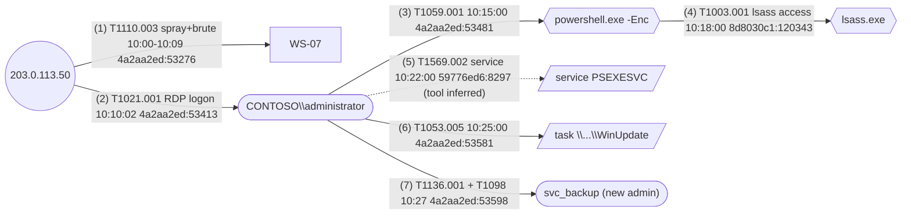

# Attack path visualisation

Produce on request. Two outputs: a Mermaid graph (always) and optionally a
self-contained HTML file embedding it.

## Mermaid conventions

- Nodes: hosts `H_<name>` (rectangles), accounts `A_<name>` (stadium
  `([...])`), processes/tools `P_<name>` (hexagons `{{...}}`), external
  IPs `X_<ip>` (circles `((...))`), artefacts (services, tasks, files)
  `F_<name>` (`[/.../]`).
- Edges: `-->` observed, `-.->` inferred. Label: technique id, UTC time
  (HH:MM:SS, add date if multi-day), event id (`<key>:<rid>`).
- Order edges chronologically. Start each label with the matching timeline
  row number in parentheses, `(6)` or `(19-20)`; inferred edges with no row have
  none. Never start a label with `1.`, `1)`, `-`, `*`, `+` or `#`: Mermaid 11
  reads labels as Markdown and draws a list as "Unsupported markdown: list".
- Keep under ~25 nodes; group noise.



## HTML file

Self-contained page: Mermaid from a pinned CDN build, the graph source, and
the timeline table. Replace `{{TITLE}}`, `{{MERMAID}}`, `{{TABLE_ROWS}}`.

```html
<!doctype html>
<html lang="en"><head><meta charset="utf-8">
<meta name="viewport" content="width=device-width,initial-scale=1">
<title>{{TITLE}}</title>
<style>
 :root{--bg:#fff;--fg:#1d1d1f;--muted:#6e6e73;--line:#d2d2d7}
 @media (prefers-color-scheme:dark){:root{--bg:#111;--fg:#f5f5f7;--muted:#a1a1a6;--line:#3a3a3c}}
 body{background:var(--bg);color:var(--fg);font:15px/1.5 system-ui,sans-serif;margin:0 auto;max-width:1200px;padding:16px}
 h1{font-size:1.4rem} .note{color:var(--muted)} table{border-collapse:collapse;width:100%;font-size:13px}
 th,td{border-bottom:1px solid var(--line);padding:6px;text-align:left;vertical-align:top} .wrap{overflow-x:auto}
</style></head><body>
<h1>{{TITLE}}</h1>
<p class="note">Solid edges: observed in logs. Dashed edges: inferred. Times UTC. Labels: (timeline row), technique, time, forhunt event id. Scroll sideways for the whole graph.</p>
<div class="wrap"><pre class="mermaid">
{{MERMAID}}
</pre></div>
<h2>Timeline</h2>
<div class="wrap"><table><thead><tr><th>#</th><th>Time (UTC)</th><th>Host</th><th>Account</th><th>Event ref</th><th>Description</th><th>ATT&amp;CK</th><th>Confidence</th></tr></thead>
<tbody>
{{TABLE_ROWS}}
</tbody></table></div>
<script type="module">
import mermaid from "https://cdn.jsdelivr.net/npm/mermaid@11.4.1/dist/mermaid.esm.min.mjs";
mermaid.initialize({startOnLoad:true, securityLevel:"strict",
  // Natural size, scrolled by .wrap: fitted to the page, a wide LR graph has unreadable labels.
  flowchart:{useMaxWidth:false},
  theme: matchMedia("(prefers-color-scheme: dark)").matches ? "dark" : "default"});
</script>
</body></html>
```
The page needs network access for the Mermaid script; for an offline copy,
render the graph to SVG with `mmdc` (mermaid-cli) and inline the SVG instead.
